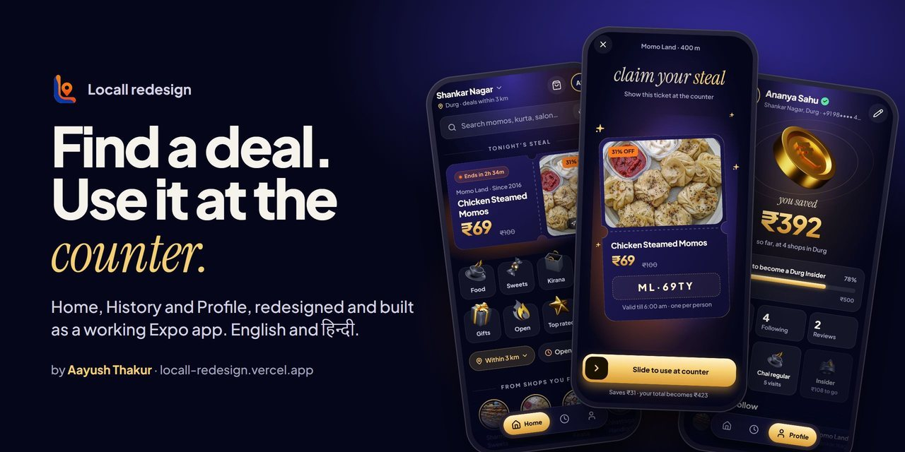
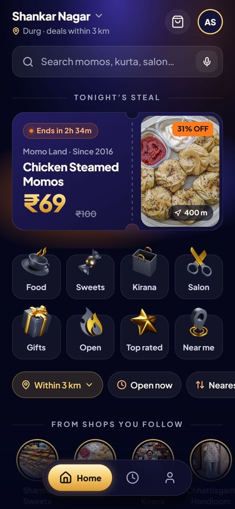
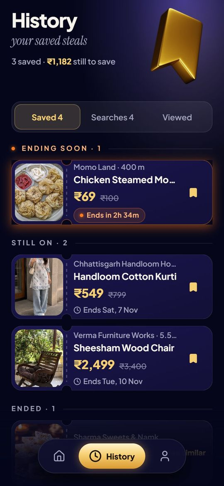
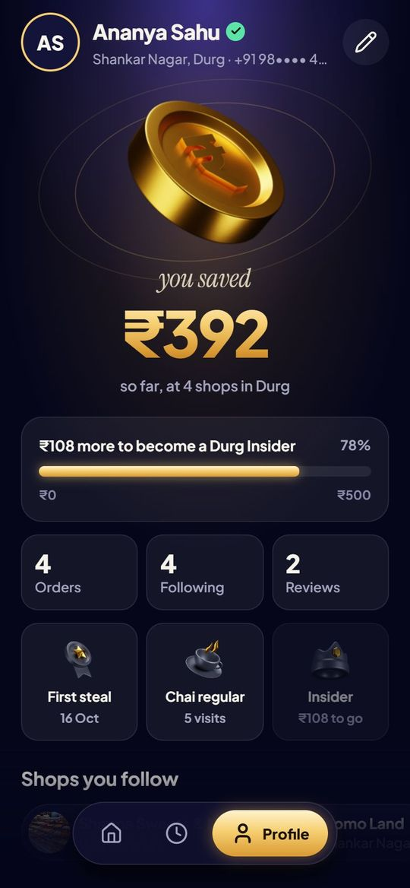
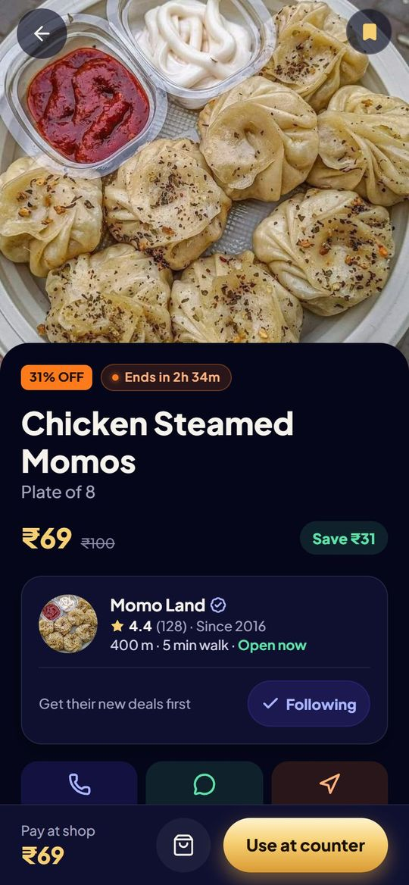
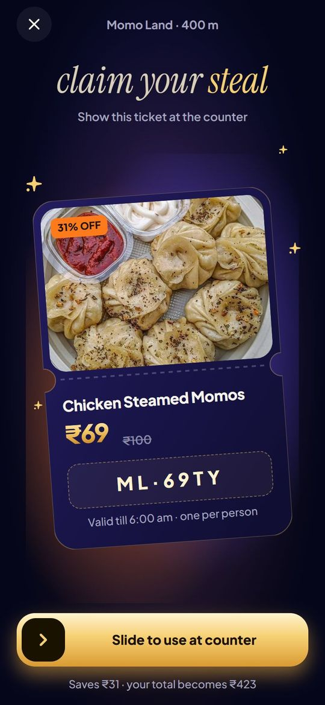
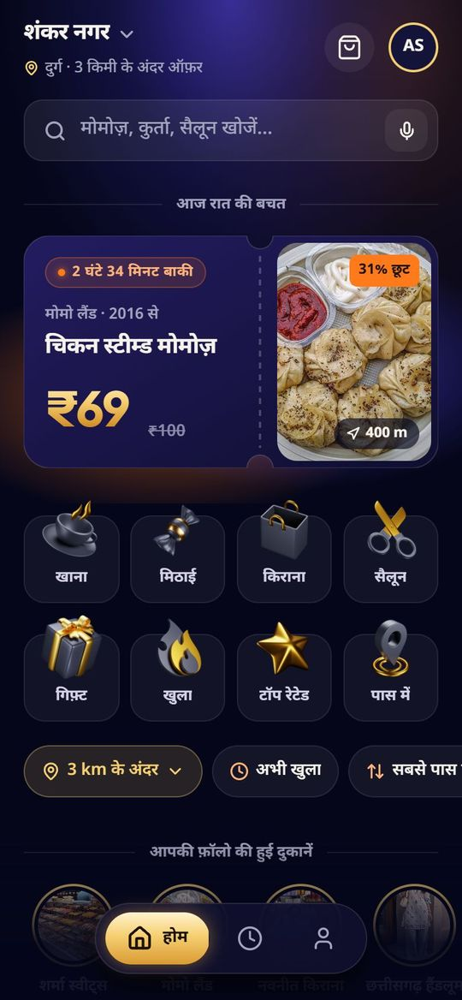
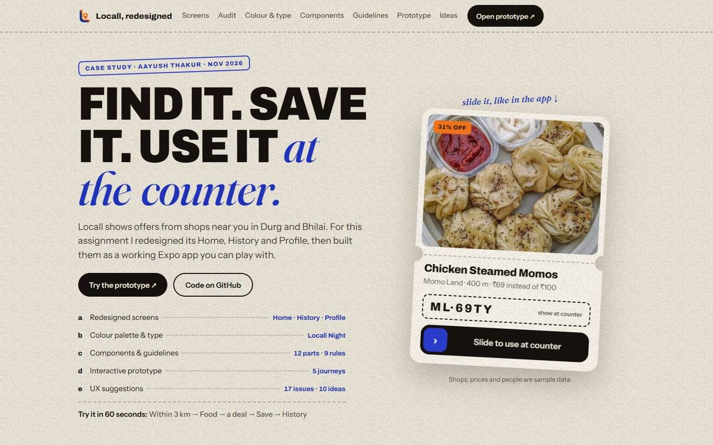

<p align="center">
  
</p>

# Locall redesign

[Locall](https://locall.co.in) shows offers from shops near you in Durg and Bhilai. For my mobile app internship assignment I redesigned its Home, History and Profile and built them as a working Expo (React Native) app.

**[Try the prototype](https://locall-redesign.vercel.app/)** · **[Read the case study](https://locall-redesign.vercel.app/case-study/)**

It opens in any phone browser. Shops, prices and people in it are sample data.

## Screens

<table>
  <tr>
    <td width="33%" align="center"><br><b>Home</b><br>Tonight's steal comes first</td>
    <td width="33%" align="center"><br><b>History</b><br>Saved deals as tickets</td>
    <td width="33%" align="center"><br><b>Profile</b><br>What you saved so far</td>
  </tr>
  <tr>
    <td width="33%" align="center"><br><b>Deal</b><br>Shop, price, one gold button</td>
    <td width="33%" align="center"><br><b>Use at counter</b><br>Slide, then show the code</td>
    <td width="33%" align="center"><br><b>हिन्दी</b><br>The whole app switches</td>
  </tr>
</table>

## What the assignment asked for

| Asked | Where it is |
|---|---|
| a) Redesigned screens | [Home](<src/app/(tabs)/index.tsx>), [History](<src/app/(tabs)/history.tsx>), [Profile](<src/app/(tabs)/profile.tsx>), plus deal, shop, search and [Use at counter](<src/app/claim/[id].tsx>) |
| b) Colour palette and type | [`src/theme/tokens.ts`](src/theme/tokens.ts), with the measured contrast ratio next to each colour |
| c) Components and guidelines | [`src/components`](src/components); the ticket, gold number, glow and photo slot are in [`night.tsx`](src/components/night.tsx). Guidelines are in the case study |
| d) Interactive prototype | [The live app](https://locall-redesign.vercel.app/), with five journeys listed in the case study |
| e) UX suggestions | The case study: 17 issues found on Locall's current screens and 10 ranked ideas |

## Try it in 60 seconds

1. On Home, tap **Within 3 km** and pick a distance.
2. Tap **Food**, then open a deal.
3. Save it with the bookmark. It shows up in **History** under Ending soon.
4. On the deal page tap **Use at counter** and slide the gold knob.
5. Open **Profile**: the saving is added to "You saved".

## What changed

- **Home:** the best deal nearby is on the first screen, with its shop, price, MRP, distance and end time. Six km chips became one radius chip, and nothing floats over the deals.
- **History:** Saved, Searches and Viewed, as the brief asked. Saved deals are grouped by when they end, searches re-run in one tap, and removing anything shows Undo.
- **Profile:** "You saved ₹" counts completed orders only. It has a real name instead of an email handle, and no coordinates.
- **Use at counter:** a new screen. You slide to use a deal and get a short code for the shopkeeper.
- **Hindi:** every label, deal, shop name and date switches live, and search understands खाना, किराना, kapde and sabzi.

The look is called Locall Night: a deep navy background, one glowing object per screen, and gold only for money. Every text colour passes 4.5:1, touch targets are at least 44 px on web, and the claim ticket and savings count-up respect reduce motion.

<p align="center">
  <a href="https://locall-redesign.vercel.app/case-study/"></a>
</p>

## Why a coded app and not a Figma file

The role is mobile app development, so I built the screens in the stack the real app could use. That also means every state actually exists: empty lists, ended deals, unknown links, Hindi and the narrow 320 px phone.

## Code map

| Path | What it does |
|---|---|
| `src/app/(tabs)/` | Home, History and Profile |
| `src/app/claim/[id].tsx` | Use at counter: the slide-to-use ticket |
| `src/app/deal`, `shop`, `search` | The screens the journeys need |
| `src/components/night.tsx` | Ticket with real notches, gold number, sky glow, photo slot |
| `src/components/tab-bar.tsx` | The floating dock |
| `src/theme/tokens.ts` | Colours with contrast ratios, type scale, spacing, motion |
| `src/i18n/strings.ts` | English and Hindi strings |
| `src/store/store.tsx` | Saved deals, searches, follows, orders and language, saved on the device |
| `src/data/catalog.ts` | Sample shops and deals for Durg and Bhilai |
| `public/case-study/` | The case study page (static HTML) |

## Built with

- **Expo SDK 58 and React Native 0.88:** one codebase for Android, iOS and the web build
- **Expo Router:** file-based screens and deep links
- **Reanimated 4:** the dock, the ticket and the count-up
- **react-native-svg:** ticket shapes, glows and gold gradients
- **expo-image and expo-haptics:** photos and the tap on save and claim
- **AsyncStorage:** keeps the demo state between visits
- **TypeScript**

## Checks

- `npx tsc --noEmit` passes and `npx expo-doctor` passes 20 of 20 checks.
- Lighthouse mobile on a production build: the case study scores 87 for performance and 100 for accessibility, best practices and SEO. The prototype scores 100 for accessibility.

## Run it

```bash
npm install
npx expo start          # press w for web, or scan the QR code with Expo Go
npx expo export -p web  # the build that is deployed, in dist/
```

To test `dist/` locally, use a server that falls back to `index.html` for app routes. The `serve` package breaks `/case-study/`.

## Limits

- There is no backend. Shops, prices, ratings and people are sample data, kept on the device.
- Call and WhatsApp open Locall's real public contact number.
- Shop open and closed status uses a fixed 6 PM clock so the demo makes sense at any hour. Deal end times use the real clock.
- On the web the first load takes a few seconds, because the app ships about 1 MB of JavaScript.

## Credits

Made by Aayush Thakur. Food and shop photos are placeholders and belong to their owners. The gold 3D icons are from [3dicons](https://3dicons.co) (CC0). Type is Plus Jakarta Sans, Instrument Serif and Noto Sans Devanagari (OFL). The Locall logo belongs to Localstack Market Pvt Ltd and is used only to show the redesign in context.
